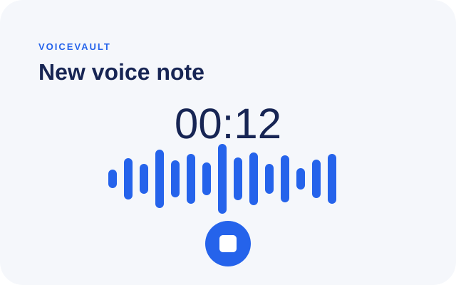

# VoiceVault

An offline-first AI voice-notes app. Record a thought, upload it when connectivity is available, and retrieve it later by meaning rather than exact keywords.



## What ships

- JWT registration and sign-in, with the token held in SecureStore.
- Record, pause, resume, cancel, and save voice notes locally with a live timer and a three-minute cap.
- SQLite-backed note store and durable retry queue. Recording saves locally before any network request.
- Processing states: Queued, Uploading, Processing, Ready, and Needs retry.
- Note detail with audio playback, summary, tags, checklist, and transcript.
- Semantic search backed by an embeddings model and cosine similarity.
- Express/MongoDB API with idempotent multipart upload, Zod validation, auth middleware, limits, and rate limiting.
- Render blueprint and an EAS profile that produces an installable Android APK.

## Pipeline

```text
Microphone
   │
   ├─ Expo Audio recorder → app document storage
   │                          │
   │                          └─ SQLite notes + upload_queue (shown immediately)
   │                                                   │
   │                                           online / exponential retry
   ▼                                                   ▼
POST /notes (JWT + multipart) ──► Mongo Note: processing ──► return 202
                                           │
                                           ├─ transcription
                                           ├─ JSON-schema LLM: title, summary, tags, actions
                                           ├─ embedding: title + summary + transcript
                                           ▼
                                   Mongo Note: ready / failed
                                           │
                         GET /notes/:id polling every 3 seconds
                                           │
                                           ▼
                      local SQLite detail UI and semantic search
```

## Project layout

```text
src/
  app/                  Expo Router screens
  api/                  authenticated API client
  audio/                recorder limits and duration formatting
  db/                   SQLite schema and note repository
  queue/                connectivity-aware upload worker
  store/                SecureStore-backed Zustand auth state
server/
  src/models/           MongoDB User and Note models
  src/routes/           auth, notes, search endpoints
  src/services/         transcription, structured summary, embedding pipeline
```

## Run locally

### API

```bash
cd server
cp .env.example .env
npm install
npm run dev
```

Set `MONGODB_URI`, `JWT_SECRET`, and `OPENAI_API_KEY` in `server/.env`. `OPENAI_BASE_URL` and the model variables make the integration work with OpenAI-compatible providers. API keys never enter the mobile bundle.

### Mobile

```bash
npm install
EXPO_PUBLIC_API_URL=http://YOUR-LAN-IP:4000 npx expo start
```

For the Android emulator use `http://10.0.2.2:4000`. Use a development build for device recording because the app adds native Expo modules.

## Deploy the API to Render

`render.yaml` is ready at the repository root. In Render, create a Blueprint from this repository and provide:

- `MONGODB_URI`
- `OPENAI_API_KEY`

Render generates `JWT_SECRET`; change it only with an intentional logout/rotation plan. The default upload storage is local disk, which is ephemeral on standard Render web services. For production, replace `audioPath` storage in `server/src/routes/notes.js` with S3, R2, or another persistent object store before relying on restarts or redeploys.

## Build an APK with EAS

Update the placeholder `EXPO_PUBLIC_API_URL` in `eas.json` to the Render service URL, then run:

```bash
npx eas-cli@latest build:configure
npx eas-cli@latest build --platform android --profile preview
```

The `preview` profile sets `android.buildType` to `apk`, so its output installs directly on Android devices. The production profile keeps the default store-oriented Android artifact.

## API contract

| Method | Endpoint | Purpose |
| --- | --- | --- |
| POST | `/auth/register` | Create account and return JWT |
| POST | `/auth/login` | Authenticate and return JWT |
| POST | `/notes` | Multipart upload: `audio`, `clientId`, `durationMs`; returns 202 |
| GET | `/notes?cursor=&limit=` | Cursor-paginated notes |
| GET | `/notes/:id` | Fetch one processed note |
| PATCH | `/notes/:id/action-items` | Update checklist state |
| POST | `/search` | Return ten semantic matches |
| DELETE | `/notes/:id` | Remove note and local audio on server |

## Limitations and production next steps

- The asynchronous pipeline runs in the web process. Use a durable job queue/worker for resilient processing and concurrency at scale.
- Semantic search calculates cosine similarity in Node and is appropriate for hundreds of notes per user. Move to Atlas Vector Search or another vector index for larger collections.
- Upload files are local to the Render instance; configure object storage for durable audio.
- The app polls while a note is processing. Push notifications are a suitable upgrade for background completion.
- Audio recording and storage have been implemented for native devices; validate the web recording path separately if web support is a release target.
